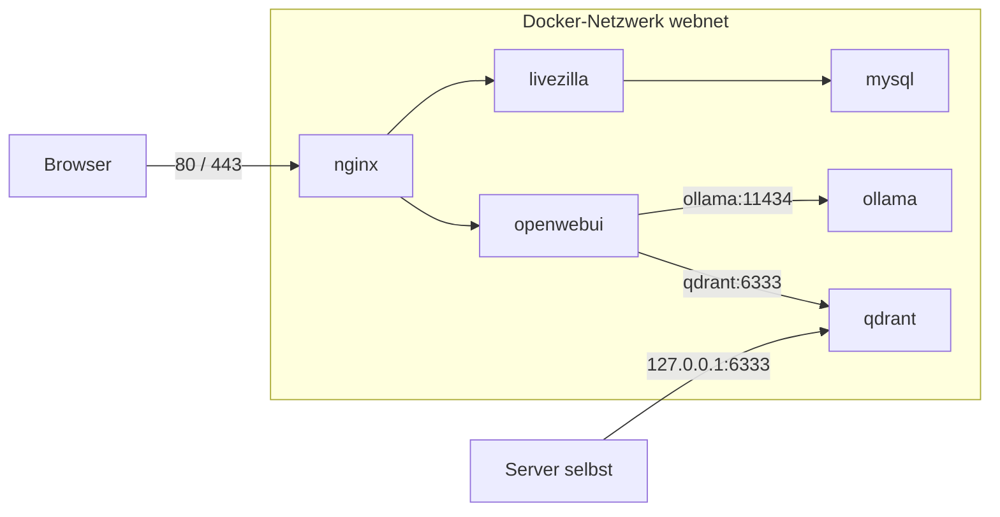
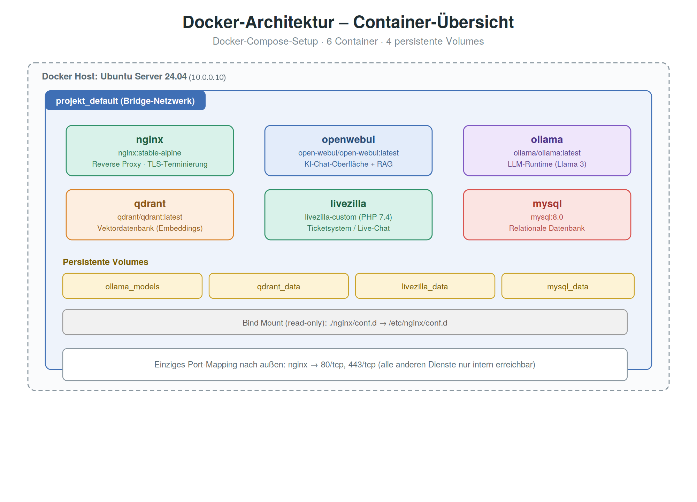
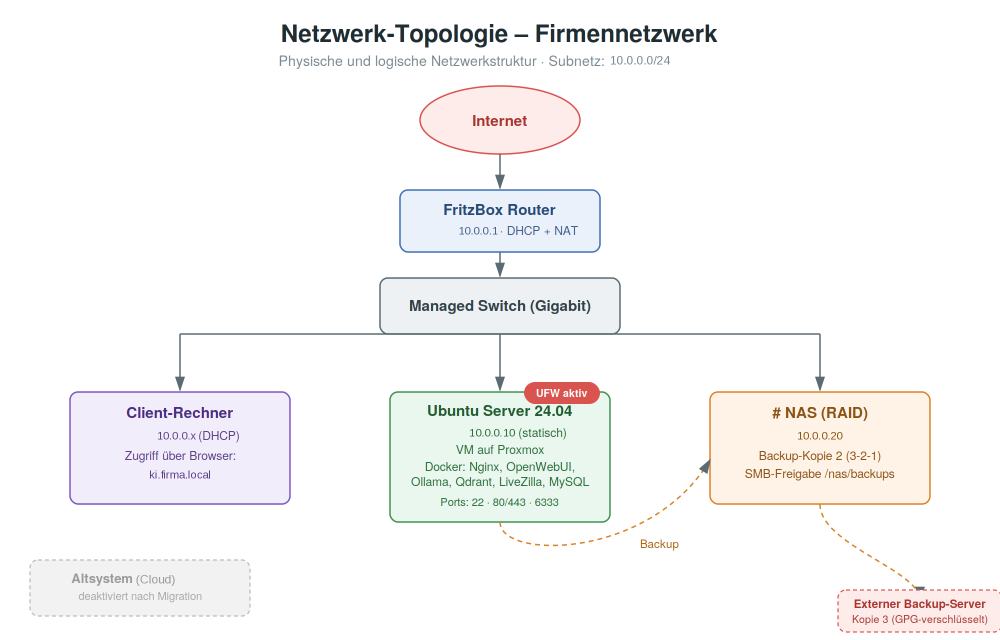
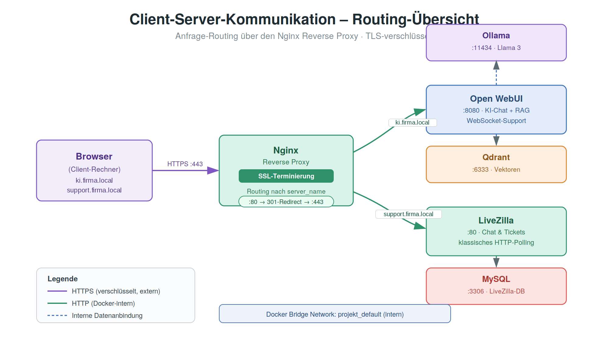
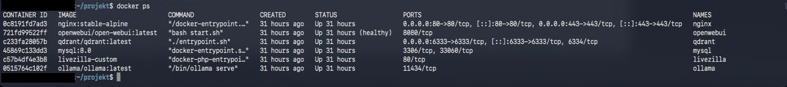
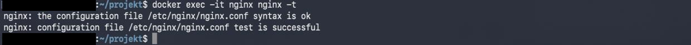
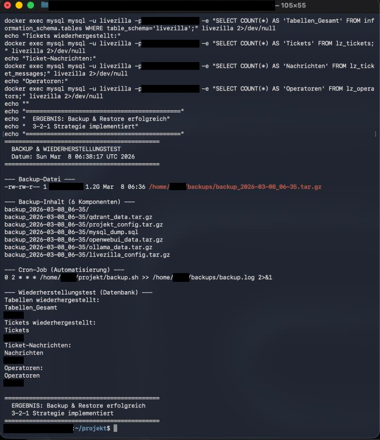

# Ticketsystem-Migration mit lokaler KI-Wissensbasis (RAG)

Ein Support-Team hat sein Ticket- und Livechat-System LiveZilla bei einem Cloud-Anbieter betrieben. Ziel war, es auf einen eigenen Server im Firmennetz zu holen. Dazu kommt ein lokales Sprachmodell über Ollama und Open WebUI, das mit Qdrant auf Support-Dokumente zugreifen kann (RAG). Die Daten bleiben damit im eigenen Netz.

## Herkunft

Die Migration war mein IHK-Abschlussprojekt als Fachinformatiker für Systemintegration. Umgesetzt habe ich sie in meinem Praktikum von September 2025 bis Ende März 2026. Dabei habe ich LiveZilla auf dem lokalen Server installiert und die Daten aus der Cloud migriert. Einiges war vom Betrieb vorgegeben.


Dieses Repo ist ein späterer Nachbau anhand meiner IHK-Projektdokumentation. Firmenname, Zugangsdaten und interne Daten sind entfernt oder anonymisiert, auch in den Bildern.

Den Nachbau habe ich mit KI-Unterstützung umgesetzt. Architektur, Review und Betrieb kommen von mir.

## Architektur

Alle Dienste laufen mit Docker Compose in einem gemeinsamen Bridge-Netzwerk (`webnet`). Die Dienste sprechen sich über ihre Service-Namen an.

| Dienst | Image | Aufgabe | Port auf dem Host |
|---|---|---|---|
| `nginx` | `nginx:stable-alpine` | Reverse Proxy für Open WebUI und LiveZilla | `80`, `443` (alle Interfaces) |
| `livezilla` | eigenes Image aus `Dockerfile-livezilla` (PHP 7.4 + Apache) | Ticketsystem und Livechat | keiner |
| `mysql` | `mysql:8.0` | Datenbank für LiveZilla | keiner |
| `openwebui` | `ghcr.io/open-webui/open-webui:main` | Chat-Oberfläche und RAG | keiner |
| `ollama` | `ollama/ollama:latest` | Laufzeit für das lokale LLM | keiner |
| `qdrant` | `qdrant/qdrant:latest` | Vektordatenbank für die Dokumente | `127.0.0.1:6333` (nur lokal) |

Wer mit wem spricht:

- `nginx` leitet Anfragen an `openwebui` und `livezilla` weiter.
- `livezilla` speichert seine Daten in `mysql`.
- `openwebui` nutzt `ollama` über `http://ollama:11434` und `qdrant` über `http://qdrant:6333`.

Von außen erreichbar ist nur nginx auf Port 80 und 443. Qdrant ist zusätzlich an `127.0.0.1:6333` gebunden, damit man auf dem Server selbst darauf zugreifen kann. Alle anderen Dienste haben keine Portfreigabe und sind nur im Docker-Netzwerk erreichbar.



Persistente Volumes: `livezilla_data`, `mysql_data`, `openwebui_data`, `ollama_models`, `qdrant_data`.

Diagramme aus dem Praktikum (anonymisiert). Sie zeigen den Stand von damals: Netzwerk `projekt_default`, 4 Volumes, Open WebUI mit `:latest` und Qdrant auf Port 6333 offen. Die compose in diesem Repo weicht davon ab, siehe Tabelle oben.





## RAG mit Open WebUI

Open WebUI ist über `VECTOR_DB=qdrant` so eingestellt, dass hochgeladene Dokumente in Qdrant landen. Bei einer Frage sucht Open WebUI passende Textstellen und gibt sie zusammen mit der Frage an das Modell in Ollama. Ein Embedding-Modell ist in der compose nicht festgelegt, Open WebUI nutzt dann seinen Standard.

## Setup

Voraussetzung: ein Linux-Server mit Docker und dem Compose-Plugin.

```bash
git clone https://github.com/UK263/ticketsystem-docker-migration-rag-KI-integration.git
cd ticketsystem-docker-migration-rag-KI-integration/docker
cp .env.example .env
```

In `docker/.env` die beiden Passwörter `DB_ROOT_PASSWORD` und `DB_USER_PASSWORD` setzen. Die `.env` steht in der `.gitignore` und wird nicht committet.

Bevor nginx etwas ausliefert, braucht es eine eigene Konfiguration und Zertifikate (siehe "Was fehlt"):

- `docker/nginx/conf.d/` für die Server-Blöcke. Open WebUI hört im Container auf Port `8080`, LiveZilla auf Port `80`.
- `docker/nginx/ssl/` für Zertifikat und Schlüssel.

Dann alles bauen und starten, weiterhin im Ordner `docker/`:

```bash
docker compose up -d --build
docker compose ps
```

Modell in Ollama laden, zum Beispiel Llama 3:

```bash
docker compose exec ollama ollama pull llama3
```

Danach ist das Modell in Open WebUI auswählbar.

LiveZilla selbst ist nicht im Image. Die Programmdateien müssen in das Volume `livezilla_data` kopiert werden, zum Beispiel:

```bash
docker compose cp ./livezilla/. livezilla:/var/www/html/
```

Im LiveZilla-Installer als Datenbank eintragen: Host `mysql`, Datenbank `livezilla`, Benutzer `livezilla`, Passwort aus `DB_USER_PASSWORD`.

## Was fehlt und Grenzen

- Die nginx-Konfiguration (`docker/nginx/conf.d`) und die Zertifikate (`docker/nginx/ssl`) liegen nicht im Repo. Ohne sie startet nginx zwar, leitet aber nichts weiter.
- Der LiveZilla-Quellcode ist nicht enthalten. LiveZilla ist kommerziell und wird seit 2020 nicht mehr weiterentwickelt. Man braucht eine eigene Kopie mit Lizenz.
- LiveZilla braucht PHP 7.4. Diese Version bekommt seit Ende 2022 keine Sicherheitsupdates mehr. Der Container sollte deshalb nicht direkt aus dem Internet erreichbar sein, und langfristig gehört ein Ersatz für LiveZilla auf die Liste.
- `ollama/ollama:latest`, `qdrant/qdrant:latest` und `open-webui:main` sind nicht auf eine Version festgelegt. Ein neuer Pull kann sich anders verhalten als beim Aufbau.
- Für Ollama ist keine GPU eingebunden. Das Modell läuft auf der CPU.
- Firewall (UFW), SSH-Härtung und das Backup-Skript mit Cron liefen im Praktikum auf dem Server. Sie sind nicht Teil dieses Repos.

## Ergebnisse im Praktikum

Diese Werte stehen in meiner IHK-Projektdokumentation. Die Doku ist nicht öffentlich, und mit diesem Repo lassen sich die Werte nicht reproduzieren.

| Kriterium | Ergebnis |
|---|---|
| Datenmigration | 100 % (alle Tabellen vollständig migriert) |
| Bearbeitungszeit pro Ticket (interne Testphase) | von durchschnittlich 25 Minuten auf 3–5 Minuten |
| Backup | täglich per Cron, Restore getestet |
| Tests bestanden | 12 / 12 |


## Screenshots aus dem Praktikum

Die Screenshots sind geschwärzt (Hostname, Benutzer, IP, Passwort, Browser-Tabs, Betriebszahlen). `docker ps` zeigt noch den alten Stand mit Qdrant auf `0.0.0.0:6333`.

| | |
|---|---|
|  `docker ps` |  `nginx -t` |
|  Open WebUI |  Backup- und Restore-Test |

## Was ich dabei gelernt habe

Am schwierigsten waren Probleme mit der Datenbank. Der LiveZilla-Installer hatte schon eigene Tabellen angelegt. Beim Einspielen des MySQL-Dumps aus der Cloud gab es deshalb Konflikte durch doppelte Einträge. Ich habe den Import dann mit `--force` laufen lassen, damit er bei diesen Fehlern nicht abbricht.


## Repo-Struktur

- `docker/docker-compose.yml`: alle Dienste
- `docker/Dockerfile-livezilla`: PHP 7.4 mit Apache, GD und MySQLi für LiveZilla
- `docker/.env.example`: Vorlage für die Passwörter
- `diagrams/`: Architektur- und Netzwerkdiagramme aus dem Praktikum, anonymisiert
- `screenshots/`: Screenshots aus dem Praktikum, geschwärzt
