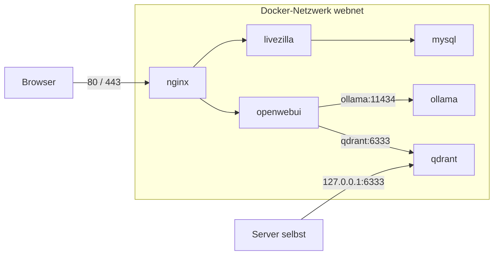
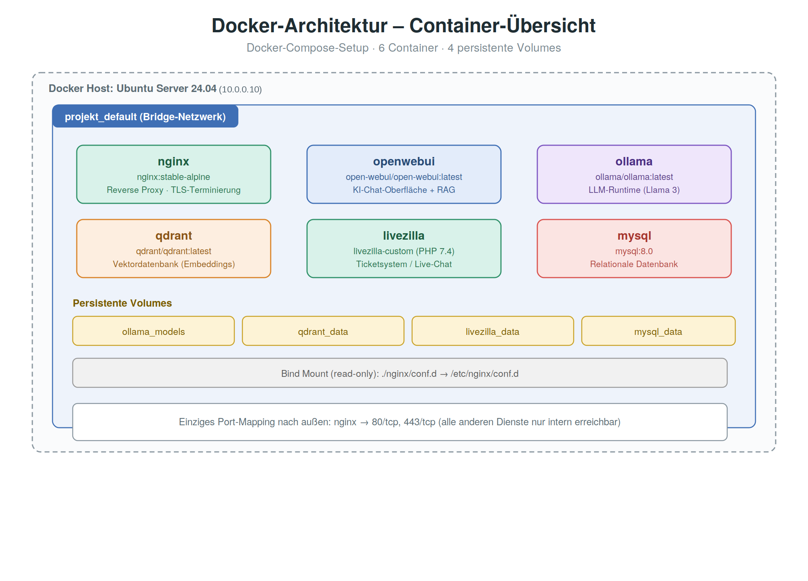
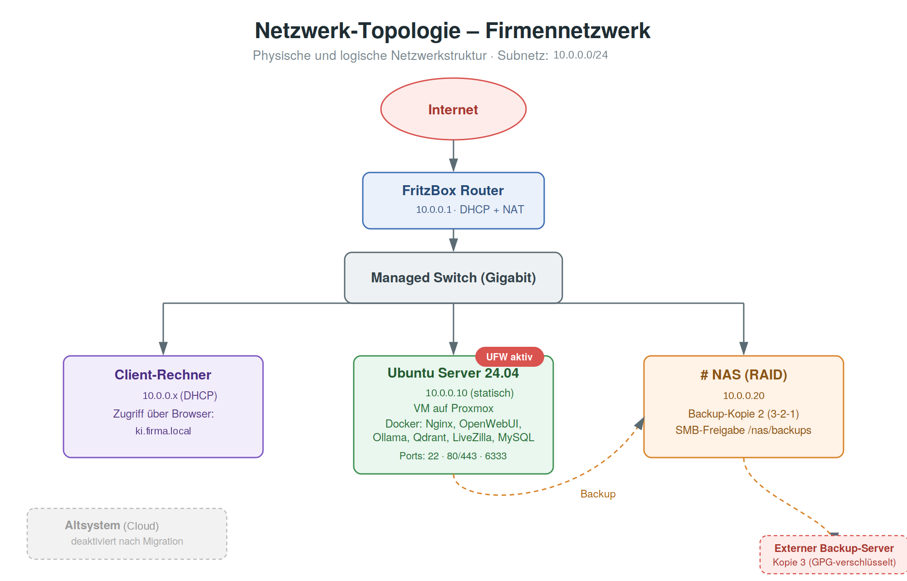
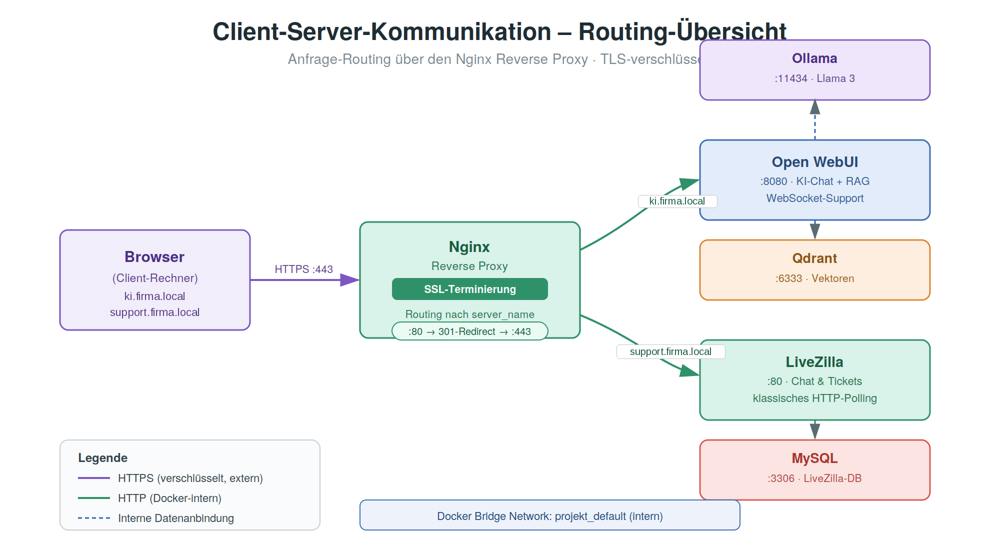
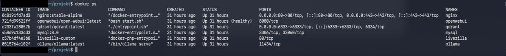
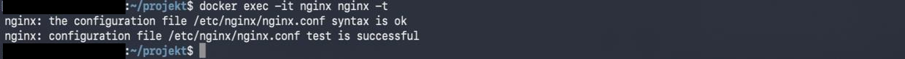
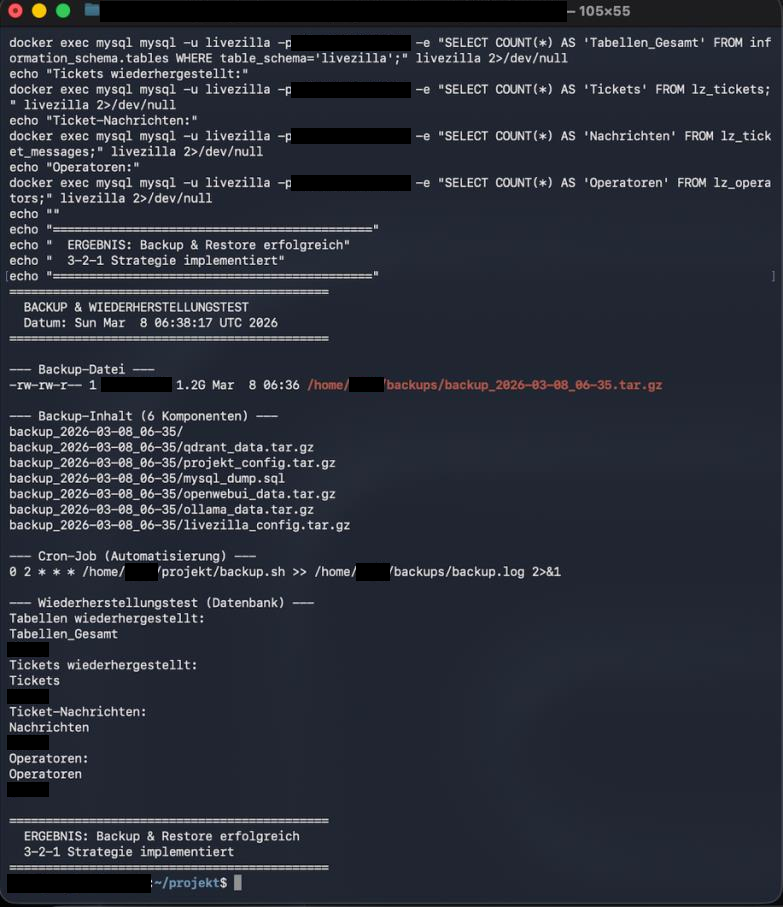

# Ticketsystem-Migration mit lokaler KI-Wissensbasis (RAG)

Ein Support-Team hat LiveZilla, das Ticket- und Livechat-System, bei einem Cloud-Anbieter betrieben. Ziel war, es auf einen eigenen Server im Firmennetz zu holen. Dazu kommt ein lokales Sprachmodell über Ollama und Open WebUI. Es kann mit Qdrant auf Support-Dokumente zugreifen (RAG). Die Daten bleiben im eigenen Netz.

## Herkunft

Die Migration war mein IHK-Abschlussprojekt als Fachinformatiker für Systemintegration. Umgesetzt habe ich sie im Praktikum von September 2025 bis Ende März 2026. LiveZilla habe ich auf dem lokalen Server installiert und die Daten aus der Cloud migriert. Einiges war vom Betrieb vorgegeben.

Dieses Repo ist ein späterer Nachbau anhand meiner IHK-Projektdokumentation, also eine anonymisierte Rekonstruktion. Firmenname, Zugangsdaten und interne Daten sind entfernt oder anonymisiert, auch in den Bildern.

Den Nachbau habe ich mit KI-Unterstützung umgesetzt. Architektur, Review und Betrieb kommen von mir.

## Architektur

Alle Dienste laufen mit Docker Compose in einem gemeinsamen Bridge-Netzwerk (`webnet`). Die Dienste sprechen sich über ihre Service-Namen an.

| Dienst | Image | Aufgabe | Port auf dem Host |
|---|---|---|---|
| `nginx` | `nginx:1.30.6-alpine` | Reverse Proxy für Open WebUI und LiveZilla | `80`, `443` (alle Interfaces) |
| `livezilla` | eigenes Image aus `Dockerfile-livezilla` (`php:7.4.33-apache`) | Ticketsystem und Livechat | keiner |
| `mysql` | `mysql:8.0.46` | Datenbank für LiveZilla | keiner |
| `openwebui` | `ghcr.io/open-webui/open-webui:v0.13.3` | Chat-Oberfläche und RAG | keiner |
| `ollama` | `ollama/ollama:0.40.16` | Laufzeit für das lokale LLM | keiner |
| `qdrant` | `qdrant/qdrant:v1.20.0` | Vektordatenbank für die Dokumente | `127.0.0.1:6333` (nur lokal) |

Die Image-Versionen sind gepinnt. Für eine neuere Version den Tag in `docker/docker-compose.yml` oder `docker/Dockerfile-livezilla` eintragen und im Ordner `docker/` mit `docker compose up -d --build` neu starten.

Wer mit wem spricht:

- `nginx` leitet Anfragen an `openwebui` und `livezilla` weiter.
- `livezilla` speichert seine Daten in `mysql`.
- `openwebui` nutzt `ollama` über `http://ollama:11434` und `qdrant` über `http://qdrant:6333`.

Von außen erreichbar ist nur nginx auf Port 80 und 443. Qdrant ist zusätzlich an `127.0.0.1:6333` gebunden, damit man auf dem Server selbst darauf zugreifen kann. Alle anderen Dienste haben keine Portfreigabe. Sie sind nur im Docker-Netzwerk erreichbar.



Persistente Volumes: `livezilla_data`, `mysql_data`, `openwebui_data`, `ollama_models`, `qdrant_data`.

Die Diagramme sind aus dem Praktikum und anonymisiert. Sie zeigen den Stand von damals: Netzwerk `projekt_default`, 4 Volumes, Open WebUI mit `:latest` und Qdrant auf Port 6333 offen. Die compose in diesem Repo weicht davon ab, siehe Tabelle oben.





## RAG mit Open WebUI

Open WebUI steht auf `VECTOR_DB=qdrant`. Hochgeladene Dokumente landen in Qdrant. Bei einer Frage sucht Open WebUI passende Textstellen und gibt sie mit der Frage an das Modell in Ollama. Ein Embedding-Modell ist in der compose nicht festgelegt. Open WebUI nutzt dann seinen Standard.

## Setup

Voraussetzung: ein Linux-Server mit Docker und dem Compose-Plugin.

```bash
git clone https://github.com/UK263/ticketsystem-docker-migration-rag-KI-integration.git
cd ticketsystem-docker-migration-rag-KI-integration/docker
cp .env.example .env
```

In `docker/.env` die beiden Passwörter `DB_ROOT_PASSWORD` und `DB_USER_PASSWORD` setzen. Die `.env` steht in der `.gitignore`. Sie wird nicht committet.

Nginx braucht noch eine Konfiguration und ein Zertifikat. Weiterhin im Ordner `docker/`:

```bash
cp nginx/conf.d/default.conf.example nginx/conf.d/default.conf
mkdir -p nginx/ssl
openssl req -x509 -nodes -days 365 -newkey rsa:2048 \
  -keyout nginx/ssl/key.pem \
  -out nginx/ssl/cert.pem \
  -subj "/CN=example.local" \
  -addext "subjectAltName=DNS:chat.example.local,DNS:support.example.local"
```

Die Vorlage leitet Anfragen auf Port 80 auf HTTPS um. `chat.example.local` geht an Open WebUI, Port 8080 im Container. `support.example.local` geht an LiveZilla, Port 80 im Container. `cert.pem` und `key.pem` liegen im Container unter `/etc/nginx/ssl`. Compose mountet den Ordner `./nginx/ssl` dorthin.

Das Zertifikat ist selbst signiert. Es ist nur für einen Test oder das LAN gedacht. Der Browser warnt dabei. `default.conf` und `docker/nginx/ssl/` stehen in der `.gitignore`. Die beiden Namen müssen vom Rechner aus auflösbar sein, zum Beispiel über die hosts-Datei.

Dann alles bauen und starten, weiterhin im Ordner `docker/`:

```bash
docker compose up -d --build
docker compose ps
```

LiveZilla startet erst, wenn der Healthcheck von MySQL (`mysqladmin ping`) erfolgreich war.

Modell in Ollama laden, zum Beispiel Llama 3:

```bash
docker compose exec ollama ollama pull llama3
```

Danach ist das Modell in Open WebUI auswählbar.

LiveZilla selbst ist nicht im Image. Die Programmdateien müssen in das Volume `livezilla_data` kopiert werden, zum Beispiel:

```bash
docker compose cp ./livezilla/. livezilla:/var/www/html/
```

Im LiveZilla-Installer als Datenbank eintragen: Host `mysql`, Datenbank `livezilla`, Benutzer `livezilla`, Passwort aus `DB_USER_PASSWORD`.

## Was fehlt und Grenzen

- `docker/nginx/conf.d/default.conf` und die Zertifikate unter `docker/nginx/ssl/` legt man lokal an, siehe Setup. Beides steht in der `.gitignore`. Ohne die kopierte `default.conf` lädt nginx daraus keinen Server-Block. Fehlen `cert.pem` oder `key.pem`, bricht der Start ab.
- Der LiveZilla-Quellcode ist nicht enthalten. LiveZilla ist kommerziell und wird seit 2020 nicht mehr weiterentwickelt. Wer es aufsetzen will, braucht eine eigene Kopie mit Lizenz.
- LiveZilla braucht PHP 7.4. Diese Version bekommt seit Ende 2022 keine Sicherheitsupdates mehr. Der Container sollte deshalb nicht direkt aus dem Internet erreichbar sein. Langfristig gehört ein Ersatz für LiveZilla auf die Liste.
- Für Ollama ist keine GPU eingebunden. Das Modell läuft auf der CPU.
- Firewall (UFW), SSH-Härtung und das Backup-Skript mit Cron liefen im Praktikum auf dem Server. Sie sind nicht Teil dieses Repos.

## Ergebnisse im Praktikum

Gemessene Zahlen habe ich dazu nicht. Die Ergebnisse beschreibe ich nur grob.

| Kriterium | Ergebnis |
|---|---|
| Datenmigration | Die Daten aus der Cloud liegen auf dem lokalen Server. Eine Prüfung Tabelle für Tabelle habe ich nicht dokumentiert. |
| Bearbeitungszeit pro Ticket | Antworten auf Standardfragen gehen spürbar schneller. Gemessen habe ich das nicht. |
| Backup | Täglich per Cron eingerichtet. Einen Restore-Test habe ich nicht dokumentiert. |
| Tests | Wie viele Tests durchliefen, habe ich nicht aufgeschrieben. |

## Screenshots aus dem Praktikum

Die Screenshots sind geschwärzt (Hostname, Benutzer, IP, Passwort, Browser-Tabs, Betriebszahlen). `docker ps` zeigt noch den alten Stand mit Qdrant auf `0.0.0.0:6333`.

| | |
|---|---|
|  `docker ps` |  `nginx -t` |
|  Open WebUI |  Backup- und Restore-Test |

## Was ich dabei gelernt habe

Am schwierigsten waren die Probleme mit der Datenbank. Der LiveZilla-Installer hatte schon eigene Tabellen angelegt. Beim Einspielen des MySQL-Dumps aus der Cloud gab es deshalb Konflikte durch doppelte Einträge. Ich habe den Import mit `--force` laufen lassen, damit er bei diesen Fehlern nicht abbricht.

## Repo-Struktur

- `docker/docker-compose.yml`: alle Dienste
- `docker/Dockerfile-livezilla`: PHP 7.4.33 mit Apache, GD und MySQLi für LiveZilla
- `docker/nginx/conf.d/default.conf.example`: Vorlage für den Reverse Proxy
- `docker/.env.example`: Vorlage für die Passwörter
- `diagrams/`: Architektur- und Netzwerkdiagramme aus dem Praktikum, anonymisiert
- `screenshots/`: Screenshots aus dem Praktikum, geschwärzt

## Lizenz

Das Repo steht unter der MIT-Lizenz. Der Text steht in [LICENSE](LICENSE).
